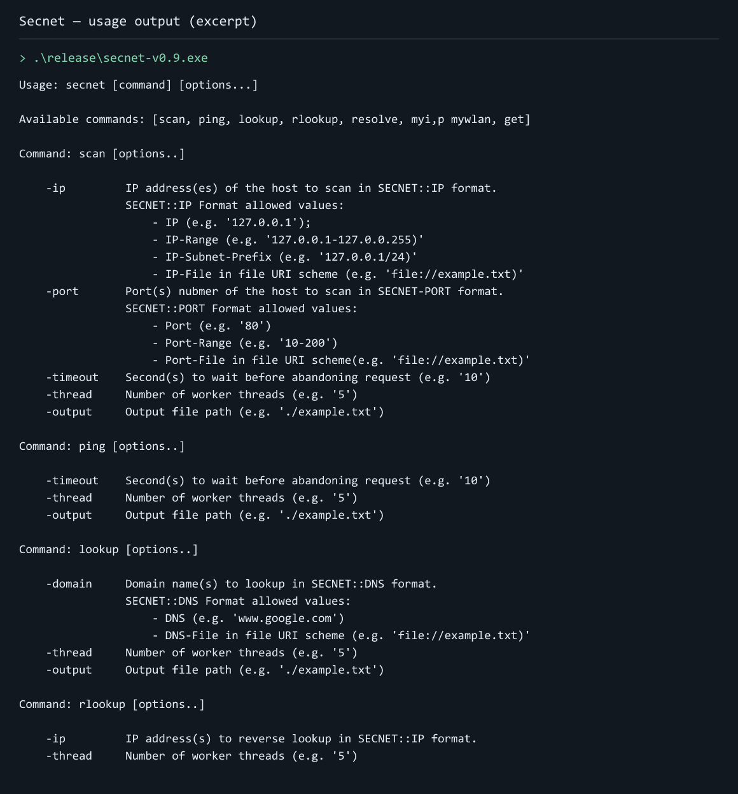

# Secnet

Secnet combines common network investigations behind a single Perl command-line interface. Check TCP connectivity and ports, perform forward or reverse DNS lookups, send HTTP GET requests, discover the external IP address, or inspect devices on a local Wi-Fi network.

Its shared options for workers, timeouts, file input, and output let you apply similar checks to multiple targets without manually repeating each lookup. It is useful for command-line troubleshooting and batch network checks, particularly in the original Windows environment where its helper utilities are supplied.



*Excerpt of the bundled Secnet CLI’s usage text, printed when run without a command.*

## Commands

- `ping` and `scan`: TCP connectivity and port checks.
- `lookup`, `rlookup`, and `resolve`: forward and reverse DNS queries.
- `get`: HTTP GET requests.
- `myip` and `mywlan`: external IP lookup and local Wi-Fi device discovery.

## Run

```sh
git clone https://github.com/Amine-Belgacem/secnet.git
cd secnet
```

The repository retains the original Windows v0.9 binaries in [release](release). For example, from PowerShell:

```powershell
.\release\secnet-v0.9.exe myip -timeout 10
```

The Perl source is [secnet.pl](secnet.pl). Running from source requires its imported modules, including Net::IP, Net::Ping, Net::DNS::Resolver, LWP::UserAgent, and Data::Validate::URI, plus thread support. Some operations rely on the Windows utilities in [utilities](utilities).

## Usage
Usage: `secnet [command] [options...]`

**Network Port Scanner over TCP**

    Command: scan [options..]
    -ip         IP address(es) of the host to scan in SECNET::IP format.
                SECNET::IP Format allowed values:
                    - IP (e.g. '127.0.0.1');
                    - IP-Range (e.g. '127.0.0.1-127.0.0.255)'
                    - IP-Subnet-Prefix (e.g. '127.0.0.1/24)'
                    - IP-File in file URI scheme (e.g. 'file://example.txt)'
    -port       Port(s) number of the host to scan in SECNET-PORT format.
                SECNET::PORT Format allowed values:
                    - Port (e.g. '80')
                    - Port-Range (e.g. '10-200')
                    - Port-File in file URI scheme(e.g. 'file://example.txt)'
    -timeout    Second(s) to wait before abandoning request (e.g. '10')
    -thread     Number of worker threads (e.g. '5')
    -output     Output file path (e.g. './example.txt')

**Ping over TCP**

    Command: ping [options..]
    -timeout    Second(s) to wait before abandoning request (e.g. '10')
    -thread     Number of worker threads (e.g. '5')
    -output     Output file path (e.g. './example.txt')

**DNS Lookup**

    Command: lookup [options..]
    -domain     Domain name(s) to lookup in SECNET::DNS format.
                SECNET::DNS Format allowed values:
                    - DNS (e.g. 'www.google.com')
                    - DNS-File in file URI scheme (e.g. 'file://example.txt)'
    -thread     Number of worker threads (e.g. '5')
    -output     Output file path (e.g. './example.txt')

**Reverse DNS Lookup**

    Command: rlookup [options..]
    -ip         IP address(s) to reverse lookup in SECNET::IP format.
    -thread     Number of worker threads (e.g. '5')
    -output     Output file path (e.g. './example.txt')

**DNS Resolver**

    Command: resolve [options..]
    -domain     Domain name(s) to resolve in SECNET::DNS format.
    -timeout    Second(s) to wait before abandoning request (e.g. '10')
    -thread     Number of worker threads (e.g. '5')
    -output     Output file path (e.g. './example.txt')

**External IP Address Discovery**

    Command: myip [options..]
    -timeout    Second(s) to wait before abandoning request (e.g. '10')

**Wi-fi Connected Devices Discovery**

    Command: mywlan [options..]
    -timeout    Second(s) to wait before abandoning request (e.g. '10')
    -thread     Number of worker threads (e.g. '5')
    -output     Output file path (e.g. './example.txt')

**GET Request Sender**

    Command: get [options..]
    -url        URL(s) to get in SECNET::URL format.
                SECNET::URL Format allowed values:
                    - URL (e.g. 'http://www.google.com')
                    - URL-File in file URI scheme (e.g. 'file://example.txt)'
    -dork       Dork(s) to get in SECNET::DORK format.
                SECNET::DORK Format allowed values:
                    - DORK (e.g. 'admin/login.php?')
                    - DORK-File in file URI scheme (e.g. 'file://example.txt)'
    -timeout    Second(s) to wait before abandoning request (e.g. '10')
    -thread     Number of worker threads (e.g. '5')
    -output     Output file path (e.g. './example.txt')
